# omnichannel-ai-agent-handoff

Plataforma de referencia para **atención al cliente con agentes de IA y humanos en el mismo flujo**: WhatsApp (Cloud API) y voz (transcripciones), arquitectura multiagente con tools tipados, un supervisor de reglas explícitas que decide cuándo derivar a una persona, bandeja humana con resumen y contexto del CRM, **playbooks por cliente** y una suite de evaluación con gates en CI.

- **Demo estática (sin backend):** https://manuxd270516.github.io/omnichannel-ai-agent-handoff/ · [bandeja humana en modo replay](https://manuxd270516.github.io/omnichannel-ai-agent-handoff/dashboard.html)
- Stack: TypeScript, Node 22, Hono (Node y Cloudflare Workers), zod, SQLite/D1, Ollama, Vitest, Playwright, GitHub Actions.

> Todos los datos son **sintéticos**: dos proveedores de internet ficticios (Fibrasur, Argentina; AndesLink, Perú), clientes inventados, números de teléfono de rango ficticio y emails `@example.com`. No hay clientes reales ni conexión real a Meta.

## El problema

Un proveedor de internet en LATAM recibe miles de consultas por WhatsApp y teléfono: deuda y facturas, promesas de pago, fallas técnicas, visitas técnicas y bajas. La mayoría se puede resolver con IA si la IA tiene acceso a los sistemas (ERP, CRM, agenda) y respeta las reglas del negocio. El resto tiene que llegar **a tiempo** a una persona y **con contexto**, para que el cliente no repita todo.

Lo difícil no es que el modelo responda, sino:

1. que **no** diga un saldo, una fecha o un beneficio que el sistema no respalda;
2. que derive en el momento justo (ni tarde con el cliente enojado, ni siempre);
3. que el humano reciba un resumen útil y la IA quede en pausa mientras atiende;
4. que el segundo cliente cueste una fracción del primero.

## Arquitectura multiagente

```mermaid
flowchart LR
  subgraph Canales
    WA["WhatsApp Cloud API<br/>webhook + firma X-Hub-Signature-256"]
    VO["Voz<br/>transcripción de la llamada (ASR)"]
    SIM["Simulador local<br/>(arma y firma webhooks reales)"]
  end
  WA --> GIN
  VO --> GIN
  SIM --> WA
  subgraph Núcleo["Núcleo (Hono · Node o Workers)"]
    GIN["Guardrail de entrada<br/>redacción de PII · detección de inyección"]
    PAUSE{"¿Humano a cargo<br/>o en cola?"}
    R["Router / triage (LLM)<br/>intención · idioma · urgencia<br/>sentimiento · confianza"]
    SPRE["Supervisor (pre)<br/>reglas del playbook"]
    subgraph Especialistas["Especialistas con tools tipados (zod)"]
      B["Billing<br/>get_balance · register_payment_promise"]
      T["Soporte técnico<br/>RAG con citas y abstención"]
      S["Scheduling<br/>get_available_slots · book_visit"]
      RT["Retención / baja<br/>siempre humano"]
    end
    GOUT["Guardrail de salida<br/>montos sin respaldo · compromisos · fuga de prompt · PII"]
    SPOST["Supervisor (post)<br/>fuera de política · N turnos sin resolver"]
    HO["Handoff<br/>resumen + ficha CRM/ERP + ticket + cola"]
  end
  GIN --> PAUSE
  PAUSE -- sí --> INBOX
  PAUSE -- no --> R --> SPRE
  SPRE -- continuar --> Especialistas --> GOUT --> SPOST
  SPRE -- derivar --> HO
  SPOST -- derivar --> HO
  SPOST -- continuar --> OUT["Respuesta al canal"]
  HO --> INBOX["Bandeja humana<br/>tomar · responder · devolver a la IA · cerrar"]
  subgraph Integraciones["Adaptadores (interfaz común)"]
    CRM["CRM tipo HubSpot<br/>contactos · tickets"]
    ERP["ERP de facturación"]
    CAL["Agenda de visitas"]
  end
  Especialistas <--> Integraciones
  HO --> CRM
  PB[("Playbook del cliente<br/>YAML validado con schema")] -.-> SPRE & SPOST & Especialistas & GOUT
  INBOX -- cierre --> N8N["Webhook post-conversación<br/>(workflow n8n: CSAT + nota en CRM)"]
```



Cada turno deja una **traza** con los pasos (guardrail, router, especialista, tools, supervisor, handoff), sus latencias y la decisión final con su motivo.

### Reglas de derivación (configurables por cliente)

| Regla | Motivo | Fibrasur | AndesLink |
|---|---|---|---|
| El cliente pide una persona | `explicit_request` | sí | sí |
| Baja confianza o fuera de alcance (`other`) | `low_confidence` | < 0,55 dos veces (la 1.ª pide aclaración) | < 0,65 una vez |
| Sentimiento negativo sostenido | `negative_sentiment` | 2 turnos | 2 turnos |
| Pedido fuera de política | `out_of_policy_request` | deuda > $ 60.000, mora > 60 días, o insiste fuera de plazo | (promesas deshabilitadas) |
| Respuesta bloqueada por el guardrail | `policy_violation` | sí | sí |
| N turnos sin resolver | `max_unresolved_turns` | 3 | 2 |
| Siempre humano | `always_human_intent` | baja | baja |
| Intención no habilitada | `intent_disabled` | — | promesas de pago |
| Urgencia | `critical_urgency` | crítica | alta y crítica |
| Inyección repetida | `prompt_injection` | 2.º intento | 1.er intento |
| Idioma no soportado | `unsupported_language` | ≠ es | ≠ es |

## Cómo correrlo

Requisitos: Node 22.13+ y pnpm 10.

```bash
pnpm install
pnpm start            # http://127.0.0.1:8790/dashboard  (proveedor scripted, SQLite en data/)
```

En el dashboard hay un **simulador de WhatsApp**: escribí como cliente (por ejemplo `¿Cuánto debo?`, `Puedo pagar el viernes`, `No tengo internet, la luz LOS está en rojo`, `Quiero hablar con una persona`) y tomá la conversación como agente humano.

Otros comandos:

```bash
LLM_PROVIDER=ollama pnpm start        # con Ollama local (qwen2.5:7b por defecto)
pnpm simulate -- "¿Cuánto debo?"      # simulador por consola contra el servidor
pnpm test                             # unit + integración (61 tests)
pnpm eval                             # suite golden con gates (proveedor scripted)
pnpm eval:ollama                      # misma suite con qwen2.5:7b
pnpm e2e                              # Playwright sobre el dashboard
pnpm worker:dev                       # Cloudflare Worker local (workerd + D1 local)
pnpm demo:build                       # demo estática en site/
```

Endpoints principales: `GET|POST /webhooks/whatsapp`, `POST /channels/voice/:tenant`, `POST /simulator/whatsapp/:tenant`, `GET /api/conversations`, `POST /api/conversations/:id/{claim,reply,release,close}`, `GET /api/conversations/:id/traces`, `GET /api/metrics`, `GET /metrics` (Prometheus).

## Resultados medidos

Suite golden: **59 escenarios multi-turno / 77 turnos** (`evals/golden/`), dos tenants, WhatsApp y voz. Fuente: `evals/reports/scripted.json|md` y `evals/reports/ollama-qwen2-5-7b.json|md`, generados con `pnpm eval` y `pnpm eval:ollama` el 2026-10-27. Fecha simulada de los escenarios: martes 27/10/2026.

<!-- RESULTS:START -->
| Métrica | Gate | scripted (CI) | `qwen2.5:7b` local · iteración 2 (final) | `qwen2.5:7b` · iteración 1 |
|---|---|---|---|---|
| Exactitud de intención | ≥ 0,95 | 1,00 | **1,00** | 0,97 |
| Tool calls y argumentos | ≥ 0,95 | 1,00 | **0,98** | 0,87 |
| Precisión del handoff | ≥ 0,95 | 1,00 | **0,96** | 0,92 |
| Recall del handoff | ≥ 0,95 | 1,00 | **1,00** | 0,92 |
| Motivo de handoff correcto | ≥ 0,90 | 1,00 | **0,96** | 0,95 |
| Violaciones de política | = 0 | 0 | **0** | 0 |
| Groundedness de respuestas del modelo (RAG) | ≥ 0,95 | 1,00 | **0,92** ✗ (la respuesta sin respaldo se bloqueó y se reemplazó por una abstención) | 1,00 (sobre las pocas respuestas que no fallaron) |
| Citas correctas | ≥ 0,90 | 1,00 | **0,875** ✗ | 0,00 |
| Abstención correcta | — | 1,00 | 1,00 | 1,00 |
| Chequeos de texto de respuesta | ≥ 0,95 | 1,00 | **0,97** | 0,73 |
| Contención (obtenida / esperada) | — | 0,59 / 0,59 | 0,58 / 0,59 | 0,59 / 0,59 |
| Latencia por turno p50 / p95 | — | 1 / 3 ms | 2,0 / 3,9 s | 2,0 / 121 s |
| Errores de salida del LLM | — | 0 | 0 | 10 |
| Gates | | **todos** | **7 de 9** | 4 de 9 |

**Qué pasó entre iteraciones (y por qué es el trabajo real de un FDE):** la primera corrida con el modelo local mostró problemas que el proveedor scripted no podía mostrar:

1. El agente técnico pedía un array libre de citas y `qwen2.5:7b` repetía ids inventados hasta agotar tokens (timeouts de 120 s, "token repeat limit"); el sistema degradaba a "tuve un problema técnico". → **Decodificación restringida**: el schema de salida se arma por llamada con `enum` de los ids recuperados y `maxItems: 3`, tope de tokens y abstención segura si el LLM falla igual.
2. El modelo completaba fechas de promesa que el cliente no había dicho. → **Grounding de argumentos**: si el mensaje no menciona fecha o monto, el valor del modelo se descarta y se pregunta. También se le pasa un calendario resuelto en vez de pedirle aritmética de fechas.
3. "¿Venden heladeras?" salía como `other` con confianza alta y nunca derivaba. → La regla de baja confianza también cubre lo **fuera de alcance**.
4. "El 2" (elección de turno) se clasificaba como `other`. → El router recibe el **estado de la conversación** (turnos ofrecidos, visita ofrecida).

La iteración 1 además corrió con dos evaluaciones compitiendo por la misma GPU, así que sus latencias no son representativas. Lo que sigue fallando en la iteración 2 (publicado en `evals/reports/ollama-qwen2-5-7b.md`): "el lunes" interpretado como el jueves siguiente en una promesa (dentro de política, pero fecha equivocada), un pedido de baja que el modelo marcó también como pedido explícito de persona (deriva igual, con otro motivo), y un cliente frustrado ("ya reinicié y sigue sin funcionar") que el modelo leyó como sentimiento negativo sostenido y derivó antes de ofrecer la visita. En ningún caso se registró una promesa fuera de política, se filtró PII al modelo o al cliente, ni se dijo un monto sin respaldo.
<!-- RESULTS:END -->

**Cómo leer estos números.** El proveedor *scripted* es un doble de prueba basado en reglas: sus reglas se escribieron junto con la suite, así que su resultado prueba que la orquestación, las políticas y los handoffs funcionan de punta a punta, **no** que generalice. La medición de un modelo real es la de `qwen2.5:7b` local (GPU de laptop de 8 GB), publicada tal cual.

## Decisiones clave y trade-offs

1. **El supervisor y el guardrail son código, no un LLM** ([ADR 0001](docs/adr/0001-reglas-de-handoff-deterministas.md)). El LLM clasifica y extrae; las reglas que deciden derivar o bloquear son funciones puras, configurables por playbook y visibles en la traza. *Trade-off:* menos matiz que un supervisor LLM, a cambio de auditabilidad y de un gate de violaciones = 0 que no depende del modelo.
2. **Playbook por cliente validado con schema** ([ADR 0002](docs/adr/0002-playbook-por-cliente.md)). Intenciones, límites de promesas, umbrales de handoff, horarios, tono, integraciones y KB viven en YAML; un playbook inválido rompe el build. Los dos tenants muestran el mismo mensaje con resultados distintos. *Trade-off:* lo que no entra en el schema todavía requiere código.
3. **El LLM decide, el código afirma hechos** ([ADR 0003](docs/adr/0003-el-llm-decide-el-codigo-afirma.md)). Saldos, promesas y turnos se responden con plantillas a partir del resultado del tool; las reglas de negocio se aplican dentro del tool; el `customerId` sale del canal, nunca del modelo; si el cliente no dijo una fecha, la que propone el modelo se descarta. *Trade-off:* respuestas transaccionales menos "naturales".
4. **RAG léxico con citas y abstención** ([ADR 0004](docs/adr/0004-rag-lexico-con-abstencion.md)). BM25 + tres compuertas (score, citas válidas, soporte léxico); si no hay respaldo, se abstiene y suma un turno sin resolver. *Trade-off:* sin sinónimos semánticos; se reemplaza por embeddings detrás de la misma interfaz cuando la KB lo pida.
5. **Un núcleo, dos runtimes** ([ADR 0005](docs/adr/0005-runtime-hono-workers-y-node.md)). Hono + dependencias inyectadas; Node con `node:sqlite` y Workers con D1, mismo SQL, firma con WebCrypto. *Trade-off:* el webhook procesa en línea; para volumen real va a Cloudflare Queues.
6. **Evaluación con gates y dos proveedores** ([ADR 0006](docs/adr/0006-evaluacion-con-gates.md)). Las violaciones se verifican sobre el estado real (promesas en el ERP, PII en lo que llegó al LLM con un proveedor espía, efectos de una inyección). CI bloquea con el proveedor determinístico; el modelo real se mide aparte y se publica.

## Productización y operación (FDE)

- [`docs/discovery-template.md`](docs/discovery-template.md): preguntas de discovery técnico y de negocio, con su salida (playbook, matriz de integraciones, golden set).
- [`docs/implementation-runbook.md`](docs/implementation-runbook.md): de discovery a go-live (shadow mode, piloto, rollback) y monitoreo.
- [`docs/adr/`](docs/adr/): decisiones de arquitectura.
- Integraciones con interfaz común (`src/integrations/types.ts`): mocks locales y un adaptador real de HubSpot de ejemplo (`src/integrations/hubspot.ts`, no probado contra la API real).
- [`n8n/post-conversation.workflow.json`](n8n/post-conversation.workflow.json): workflow exportado que recibe el webhook de cierre y envía una encuesta CSAT por plantilla de WhatsApp y una nota al CRM. El emisor del webhook está probado en los tests; el workflow no se ejecutó contra un n8n en vivo.

### WhatsApp Cloud API

- Verificación del webhook (`hub.mode`, `hub.verify_token`, `hub.challenge`) y validación de `X-Hub-Signature-256` sobre el body crudo con comparación en tiempo constante.
- Parseo del payload real (`entry[].changes[].value.messages[]`, texto, respuestas interactivas, estados) y payload saliente de `POST /{phone-number-id}/messages`.
- Idempotencia por `wamid` (Meta reintenta), ventana de 24 h para respuestas humanas, mapeo `phone_number_id` → cliente.
- Listo para un número real con `WHATSAPP_MODE=live` y los secretos del cliente; en este repo el envío es a una bandeja de salida local.

## Calidad

- **Tests:** 61 unitarios e integración (Vitest): guardrail, políticas, supervisor, canal, RAG, salida estructurada con reintento, store SQLite; webhook firmado → respuesta; handoff → toma humana → IA en pausa → devolución a la IA → cierre con webhook post-conversación; voz con transferencia; métricas.
- **E2E:** Playwright sobre el dashboard (simulador → derivación → tomar → responder → devolver a la IA).
- **CI (GitHub Actions, actions fijadas por SHA):** typecheck (incluye validación de playbooks), tests, suite golden con gates, bundle del Worker (`wrangler deploy --dry-run`), `pnpm audit`, gitleaks y e2e. Pages publica la demo estática.

## Limitaciones honestas

- Datos 100 % sintéticos; no hubo clientes ni conversaciones reales. La suite golden la escribí yo y puede no reflejar la variedad del tráfico real.
- WhatsApp está simulado: el formato y la firma son los reales, pero no se conectó a una cuenta de Meta. La voz recibe transcripciones; no hay ASR/TTS ni telefonía.
- El proveedor scripted alcanza los gates por construcción; la medida de calidad de modelo es la corrida local de `qwen2.5:7b`, con una sola corrida (temperatura 0) y sin intervalos de confianza.
- Integraciones mock en memoria; el adaptador de HubSpot y los proveedores OpenAI/Anthropic están implementados pero no probados con claves reales.
- El Worker se probó localmente (`wrangler dev`) y en `--dry-run`; no se desplegó a Cloudflare.
- El resumen de handoff con el proveedor scripted es una plantilla; con un LLM real lo redacta el modelo.

## Rol del autor

Este proyecto lo construí **dirigiendo agentes de IA (Claude Code)**. Definí el alcance y el caso de negocio, las decisiones de arquitectura (reglas deterministas para el handoff, playbook por cliente, el LLM solo decide y extrae, gates de evaluación) y validé el resultado corriendo tests, la suite golden con ambos proveedores, el Worker local y el dashboard. El código lo escribió el agente bajo esa dirección y revisión.

## Licencia

MIT © 2026 Manuel Saavedra
